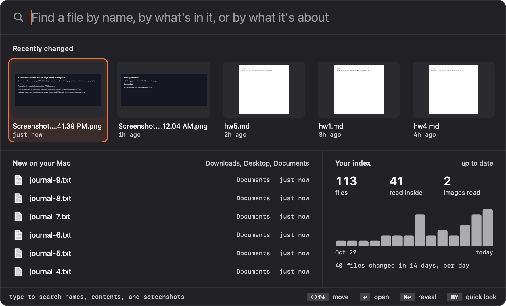
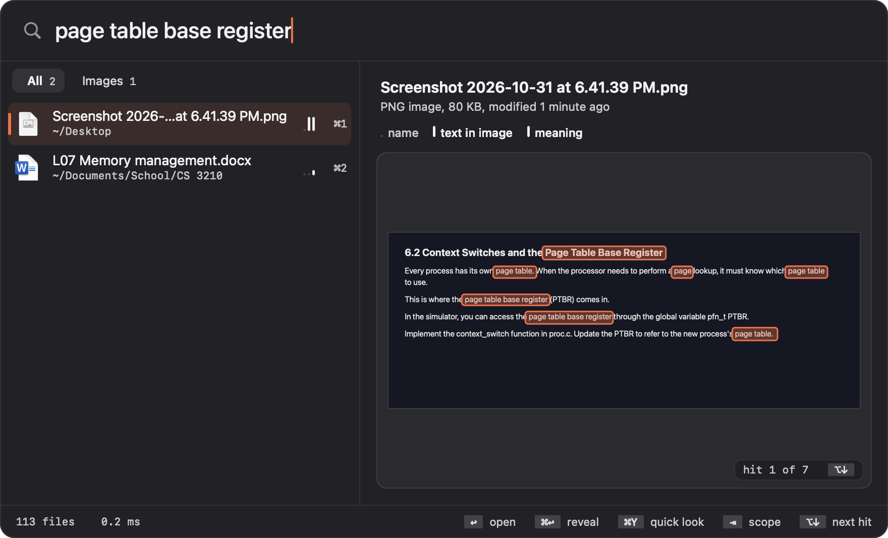
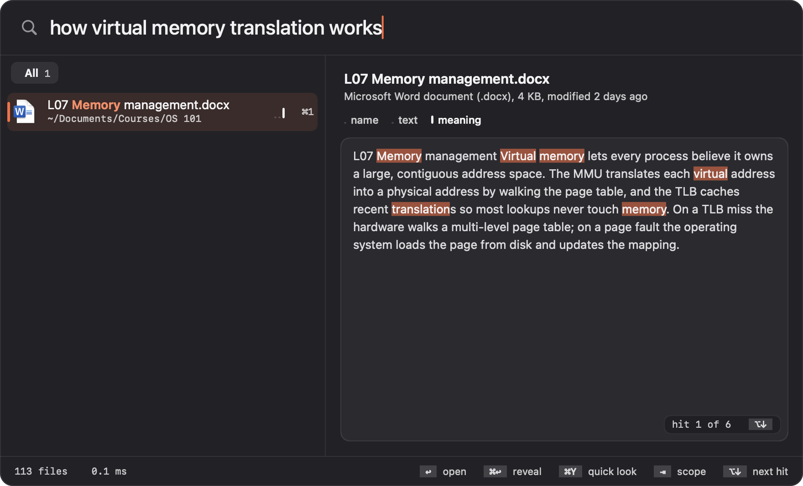
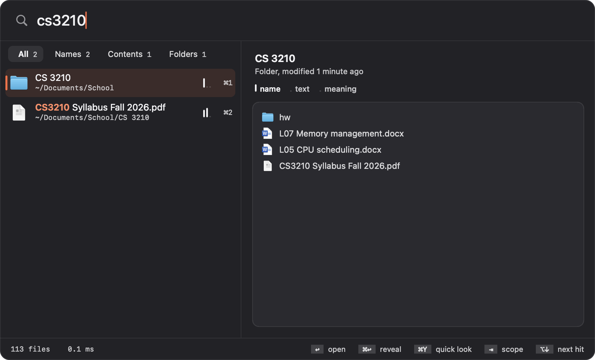

<h1 align="center">Seek</h1>

<p align="center">
  <b>The file search Finder should have.</b><br/>
  Names, contents, text inside screenshots, and meaning — in about a millisecond, entirely on your Mac.
</p>

<p align="center">
  
  
  
  
  <br/>
  <a href="https://github.com/mtjia6/seek/releases/latest"></a>
  <a href="https://github.com/mtjia6/seek/releases/latest"></a>
  <a href="https://github.com/mtjia6/seek/actions/workflows/ci.yml"></a>
</p>

<p align="center">
  Press <kbd>⌥ Space</kbd>, type, press <kbd>↩</kbd>.
</p>

<p align="center">
  
</p>

---

## Find it the way you remember it

You remember a file by *something*: its exact name, a phrase inside it, what was on the screenshot, or just what it was about. Seek searches all four at once and merges them into one ranked list.

| You type | Seek finds |
|---|---|
| `Quarterly Budget Final` | the file with exactly that name — always first |
| `q3report` | `Q3-Report/`, `Q3 Report Draft.pdf` (separators and case don't matter) |
| `lease agreement` | the PDFs that *say* "lease agreement", with the line highlighted |
| `page table base register` | the screenshot of your lecture slide that shows those words |
| `how virtual memory translation works` | `L07 Memory management.docx` — no shared keywords needed |

Every result shows *why* it matched:

<table>
  <tr>
    <td width="50%"></td>
    <td width="50%"></td>
  </tr>
  <tr>
    <td><b>Inside a PDF.</b> The page region with your phrase highlighted; <kbd>⌥↓</kbd> steps through every hit.</td>
    <td><b>Inside a screenshot.</b> Text read by OCR, boxed where it appears in the image.</td>
  </tr>
  <tr>
    <td></td>
    <td></td>
  </tr>
  <tr>
    <td><b>By meaning.</b> A question finds the lecture document; the meter shows only the meaning signal fired.</td>
    <td><b>By name.</b> <code>os101</code> finds <code>OS 101</code>; separators and case don't matter.</td>
  </tr>
</table>

<sub>Screenshots use a demo folder of sample files.</sub>

## Why not Finder?

Finder's search box is a front end to Spotlight's index. When that index is stale, incomplete, or excludes a folder, typing the **exact** file name still returns nothing. Seek keeps its own index, built from the real filesystem and kept current with FSEvents, so if a file exists, it is found.

| | Seek | Finder / Spotlight |
|---|---|---|
| Exact name always ranked first | ✅ | ❌ mixed with content hits |
| Independent of Spotlight's index health | ✅ | ❌ |
| Typo- and separator-tolerant (`q3report` → `Q3-Report`) | ✅ | ❌ word prefixes only |
| Unicode-normalized names (NFD, U+202F in screenshot names) | ✅ | partial |
| Full text in code, PDF, DOCX, PPTX, XLSX | ✅ | ✅ |
| Text inside screenshots and photos (OCR) | ✅ | partial (Live Text, not reliably indexed) |
| Find by meaning, no shared words | ✅ | ❌ |
| Boosts the folder open in your front Finder window | ✅ | ❌ |
| Learns from what you open | ✅ | partial |

## Features

- **Instant name search.** Every file name under your home folder, `/Applications`, iCloud Drive and `~/Library/CloudStorage` lives in memory and is scanned on all cores per keystroke.
- **Tiered ranking.** Exact name → starts with → word match → substring → all words → fuzzy. Frecency and recency reorder results *within* a tier, never across it, so a popular file can't bury your exact match.
- **Full-text search.** SQLite FTS5 with BM25 ranking; the last word matches as a prefix, so results arrive while you type.
- **OCR.** Screenshots, photos and scans are read once with Apple Vision.
- **Semantic search.** Every document gets a 256-d vector from [potion-base-8M](https://huggingface.co/minishlab/potion-base-8M), a Model2Vec static embedding model, scanned exactly with Accelerate.
- **Hybrid fusion.** The three retrievers run concurrently and merge with Reciprocal Rank Fusion; weights adapt to whether the query looks like a filename, a word, or a question.
- **Live index.** Creates, edits, renames, folder moves and deletes are reflected within ~1 s (names) to ~2 s (contents).
- **Evidence pane.** The selected result shows *why* it matched: the PDF page region with your words highlighted, the screenshot with boxes where OCR found them, the numbered code lines, or the matching passage. Step through hits with <kbd>⌥↓</kbd>.
- **Match meter.** Three thin bars on every row show how strongly the name, the text and the meaning matched.
- **Home screen.** Before you type: thumbnails of files you opened recently, what just arrived in Downloads/Desktop/Documents, index health, and a 14-day activity chart. Click a day to list what changed.
- **Folder filter.** `work/budget` limits results to paths containing `work`.
- **Date filter.** `changed:today`, `changed:yesterday`, `changed:mon` (any weekday) or `changed:2026-10-30`, optionally with more words.

## Setup

### Download (easiest)

1. Download **`Seek-<version>.zip`** from the [latest release](https://github.com/mtjia6/seek/releases/latest), unzip it, and drag `Seek.app` into **Applications**. It runs on Apple silicon and Intel Macs with macOS 14 or later.
2. Open it. Seek isn't notarized by Apple yet, so macOS blocks the first launch: click **Done**, then go to **System Settings → Privacy & Security** and click **Open Anyway** next to Seek. You only do this once per version.

### Or build from source

**Requirements:** macOS 14 or later, and the Xcode command-line tools (`xcode-select --install`). About 40 MB of disk for the app and the embedding model.

```sh
git clone https://github.com/mtjia6/seek.git
cd seek
./build.sh
```

`build.sh` downloads the embedding model on first run (MIT, 30 MB, not stored in git), builds a release binary, bundles and signs `Seek.app`, copies it to `~/Applications`, and launches it.

### After installing

A magnifying-glass icon appears in the menu bar. Seek has no Dock icon.

**Allow folder access.** macOS asks once each for Desktop, Documents and Downloads. Click **Allow**; Seek can only index what you allow. If you clicked Don't Allow, turn it back on in **System Settings → Privacy & Security → Files and Folders → Seek**.

**Wait for the first index.** File names are ready in under a second. Reading contents takes a minute or two in the background (a few minutes more if you have many screenshots to OCR). The menu bar menu and the home screen show progress, and you can search while it runs.

**Start at login (optional):** **System Settings → General → Login Items → +**, then choose `Seek.app`.

**To update:** download the new release and replace the app, or `git pull && ./build.sh`. Your index is kept.

**To uninstall:** quit Seek from its menu, then delete `Seek.app` and `~/Library/Application Support/Seek/`.

## Usage

Press <kbd>⌥ Space</kbd> anywhere to open Seek. (If another app already owns that shortcut, Seek uses <kbd>⌃⌥ Space</kbd>.) Press <kbd>Esc</kbd> to close.

**Before you type**, the home screen shows files you opened or changed recently, what just arrived in Downloads, Desktop and Documents, and a 14-day activity chart. Use the arrow keys and <kbd>↩</kbd> to open one, or click a day in the chart to list what changed that day.

**Type anything you remember about the file:**

| To find a file by | Type | Example |
|---|---|---|
| its name, or part of it | the words, any case, any separators | `q3report`, `budget final` |
| words inside it | a phrase from the text | `security deposit refundable` |
| text in a screenshot or photo | words you saw in the image | `page table base register` |
| what it's about | a question or description | `how virtual memory translation works` |
| its folder | folder, a slash, then the name | `work/budget` |
| when it changed | `changed:` plus a day, optionally more words | `changed:yesterday pdf`, `changed:mon`, `changed:2026-10-30` |

**Read the results.** The right pane shows why the selected file matched: the highlighted PDF page, the boxed words in a screenshot, the numbered code lines, or a folder's contents. The three bars on each row show how strongly the **name**, the **text** and the **meaning** matched. Press <kbd>⇥</kbd> to narrow results to Names, Contents, Images or Folders.

**Act on a result:** <kbd>↩</kbd> opens it, <kbd>⌘ ↩</kbd> reveals it in Finder, <kbd>⌥ ↩</kbd> copies its path, and <kbd>⌘Y</kbd> previews it with Quick Look. Seek remembers what you open and ranks those files higher next time, but never above an exact name match.

**Menu bar menu:** shows index progress, has **Rebuild Index** (if results ever look stale), and **Quit Seek**.

### All keys

| Key | Action |
|---|---|
| <kbd>⌥ Space</kbd> | Show / hide Seek (falls back to <kbd>⌃⌥ Space</kbd> if taken) |
| <kbd>↑</kbd> <kbd>↓</kbd> | Move selection |
| <kbd>↩</kbd> | Open |
| <kbd>⌘ ↩</kbd> | Reveal in Finder |
| <kbd>⌥ ↩</kbd> | Copy path |
| <kbd>⌘Y</kbd> | Quick Look |
| <kbd>⌘1</kbd>–<kbd>⌘9</kbd> | Open that result |
| <kbd>⇥</kbd> / <kbd>⇧⇥</kbd> | Next / previous scope (All, Names, Contents, Images, Folders) |
| <kbd>⌥↓</kbd> <kbd>⌥↑</kbd> | Next / previous hit inside the selected file |
| <kbd>←</kbd> <kbd>→</kbd> | Move between cards on the home screen |
| <kbd>Esc</kbd> | Clear the query, then close |

## How it works

```
                    ┌──────────── indexing (background, continuous) ────────────┐
 filesystem ──walk──► name index (memory)                                        │
     │              │                                                            │
     └──FSEvents────► content indexer ──extract──► SQLite FTS5 (BM25)            │
                    │                  └─embed───► vectors (SQLite + memory)     │
                    └────────────────────────────────────────────────────────────┘
                    ┌──────────── search (per keystroke, ~1–8 ms) ──────────────┐
 query ──┬─► name matcher ──┐                                                    │
         ├─► FTS5 BM25 ─────┼─► Reciprocal Rank Fusion ─► pin exact names ─► UI  │
         └─► vector scan ───┘                                                    │
                    └────────────────────────────────────────────────────────────┘
```

Nothing reads your files at search time; every keystroke queries structures built ahead of time.

| Component | File | Notes |
|---|---|---|
| Name index + FSEvents | `FileIndex.swift` | parallel `readdir` walk with a shared work stack; packages (`.app`, `.framework`) indexed as one item |
| Name matching | `Matcher.swift` | byte-level normalization (case, diacritics, NFD, whitespace variants, `_`/`-`) |
| Extraction | `Extractor.swift` | text/code, PDFKit, `NSAttributedString` (doc/docx/rtf/odt), unzip+XML (pptx/xlsx), Vision OCR |
| Content store | `ContentStore.swift` | FTS5, WAL mode, separate reader/writer connections |
| Incremental sync | `ContentIndexer.swift` | files remembered by (mtime, size); FSEvents changes coalesced over 1 s |
| Embeddings | `StaticEmbedding.swift`, `Semantic.swift` | WordPiece tokenizer + table lookup + mean, in pure Swift; no ML runtime |
| Fusion + ranking | `Search.swift` | RRF (k = 60) with query-shape routing, `changed:` filter |
| Panel | `Panel.swift`, `Rows.swift`, `Home.swift` | results list, scope tabs, match meter, home screen |
| Evidence | `Evidence.swift`, `EvidencePane.swift` | PDF crops, OCR hit boxes, code excerpts; loaded off the main thread |
| Design tokens | `Theme.swift` | one accent, AA-checked text colors, nested radii, motion timings |

### Why potion-base-8M

Measured on 5 natural-language queries over 3.8k of the author's own documents (MRR, higher is better):

| Model | MRR | Embed cost |
|---|---|---|
| Apple `NLEmbedding` (sentence) | 0.014 | 28 ms / doc |
| Apple `NLContextualEmbedding` + mean-centering | 0.224 | 16 ms / doc |
| **potion-base-8M, name + first 100 words** | **0.557** | **0.7 ms / doc** |
| potion-base-8M, 200-word windows, best window | 0.161 | 0.5 ms / window |

Model2Vec distills a sentence transformer (bge-base-en-v1.5) into a single token→vector table, so inference is a lookup and an average, but the vectors keep the teacher's retrieval training. Many windows per file *lost*: each extra window is another chance at a spuriously high cosine, so long noisy files float up.

## Command-line modes

Useful for benchmarking and testing; each builds its own index and exits.

```sh
.build/release/Seek --query "exact name" "q3report"        # name search
.build/release/Seek --content "lease agreement" --hybrid    # full pipeline
.build/release/Seek --content "virtual memory" --semantic   # meaning only
.build/release/Seek --watch-test                            # live-update self-test
```

## Performance

Apple M4 Pro, 14 cores, macOS 27, release build, the author's home folder (19k items, 4.5k with extractable content). Query times are best of 5.

| What | Result |
|---|---|
| Full name walk, cold | **0.15 s** for 19,173 items |
| Name search | **0.2–1.5 ms** |
| Full-text search incl. snippets | **0.5–3 ms** |
| Semantic search (embed query + scan all vectors) | **0.1–0.2 ms** |
| Hybrid search, end to end | **1–8 ms** |
| First content index, text/PDF/Office (3.5k docs) | 17 s, background |
| First OCR pass (1,050 images) | ~2 min, background, ~0.12 s / image |
| Embedding every document | ~1 s |
| Re-sync on launch with nothing changed | **0.1–0.6 s** |

## Privacy

- Everything runs on your Mac. No network access after `build.sh` downloads the model.
- The index lives in `~/Library/Application Support/Seek/`; delete that folder to wipe it.
- Never entered: hidden folders (`.ssh`, `.git`, …), `~/Library` (except cloud folders), `node_modules`, `site-packages`.
- Names only, contents never read: virtualenvs, Go module cache, `build/`, `dist/`, `target/`, `vendor/`.
- The only Apple Event Seek sends is asking Finder for its front window's folder, to boost results there.

## Status

Working and in daily use on one machine. Known gaps:

- English-only semantic search (the model is English).
- External drives under `/Volumes` aren't indexed yet.
- Very long or noisy queries can surface weak full-text matches (e.g. CSS files containing common words).

## What might come next

- More query filters: `kind:pdf`, `in:Downloads`, date ranges like `changed:last week`.
- External volumes.
- int8-quantized vectors and multilingual embeddings.
- A launchd agent with `KeepAlive` so indexing survives crashes.

## Credits

- Hybrid retrieval design and query-shape routing inspired by [Kensaku](https://github.com/yjid/kensaku).
- Semantic search uses [potion-base-8M](https://huggingface.co/minishlab/potion-base-8M) by [Minish Lab](https://github.com/MinishLab/model2vec) (MIT).

## Contributing

Issues and pull requests are welcome; see [CONTRIBUTING.md](CONTRIBUTING.md) for how to build, test, and retake the screenshots. Security issues: please follow [SECURITY.md](SECURITY.md).

## License

[MIT](LICENSE). The potion-base-8M model downloaded by `build.sh` is also MIT-licensed.
